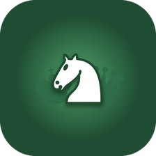
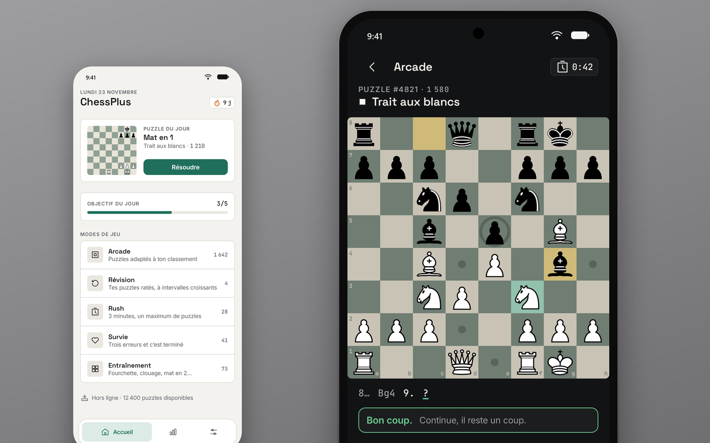
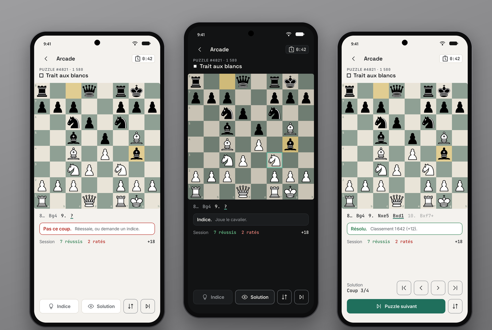
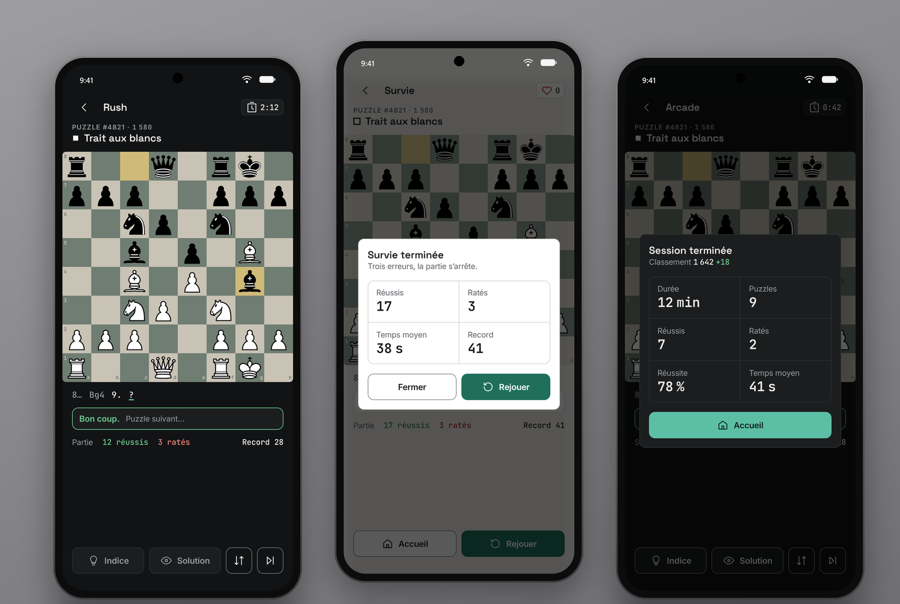
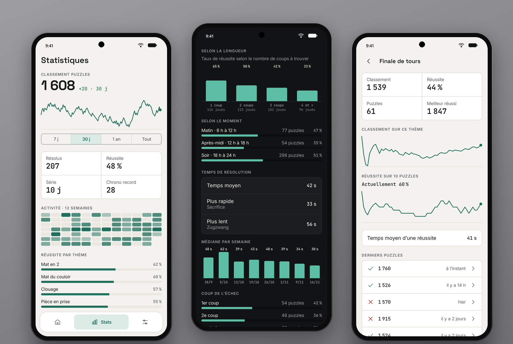
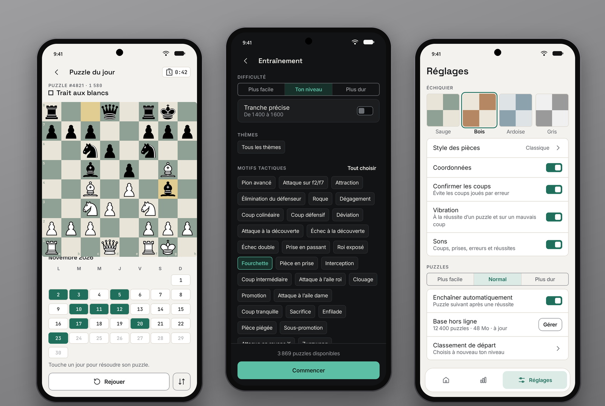

<p align="center">
  
</p>

<h1 align="center">ChessPlus</h1>

<p align="center">
  Des puzzles d'échecs, <b>partout et sans réseau</b>.<br>
  Près de 300 000 puzzles tirés de la base Lichess, choisis à ton niveau.<br>
  Pas de compte, pas de publicité, pas d'abonnement.
</p>

<p align="center">
  <a href="https://github.com/Maubin76/ChessPlus/actions/workflows/ci.yml"></a>
  <a href="https://github.com/Maubin76/ChessPlus/releases/latest"></a>
  
  
</p>

<p align="center">
  
</p>

## En bref

ChessPlus est un entraîneur tactique de poche. Le métro, la salle d'attente ou le mode
avion : un puzzle tient toujours dans deux minutes.

- **Toujours à ton niveau** : un classement Glicko-2, comme sur Lichess, s'ajuste après
  chaque puzzle et choisit les suivants dans ta tranche.
- **Entièrement hors ligne** : les puzzles sont dans l'application. Elle ne demande même
  pas l'accès à internet.
- **Tu progresses vraiment** : les puzzles ratés reviennent en révision à intervalles
  croissants, et les statistiques montrent où tu bloques, thème par thème.
- **Un rendez-vous chaque jour** : le puzzle du jour, un objectif quotidien avec son
  rappel, et une série de jours à faire durer.

## Résoudre

<p align="center">
  
</p>

Touche ou fais glisser une pièce : chaque coup est vérifié aussitôt, et l'adversaire
répond tout seul.

- **Un retour franc** : vibration et case qui s'illumine au dernier coup trouvé ; en cas
  d'erreur, l'échiquier tremble et la case vire au rouge.
- **Un indice qui laisse chercher** : il montre la pièce à jouer, pas le coup.
- **La solution, à ton rythme** : à la fin du puzzle, rejoue-la coup par coup, avant ou
  arrière, en notation algébrique.
- **Tous les mats comptent** : un autre mat que celui de la solution est accepté.
- **Sans fausse manœuvre** : confirmation des coups au choix.

## Les modes de jeu

<p align="center">
  
</p>

| Mode | Le principe |
|---|---|
| **Arcade** | Les puzzles s'enchaînent, adaptés à ton classement |
| **Entraînement** | Choisis tes thèmes parmi 73 (fourchette, clouage, mat en 2…) et ta difficulté |
| **Révision** | Tes puzzles ratés reviennent après 1, 3, 7, 14 puis 30 jours, jusqu'à ce qu'ils soient acquis |
| **Rush** | Un maximum de puzzles en 3 minutes ; une erreur fait passer au suivant |
| **Survie** | Une difficulté qui monte à chaque puzzle, et seulement trois vies |
| **Puzzle du jour** | Un nouveau puzzle chaque jour, avec le calendrier des jours résolus |

Rush et Survie ont leurs propres records et ne touchent pas à ton classement. Chaque
session se termine sur un récapitulatif : durée, réussis, ratés, temps moyen, évolution
du classement.

## Suivre ta progression

<p align="center">
  
</p>

- **Ton classement** sur 7 jours, 30 jours, un an ou depuis le début.
- **Ton activité** sur douze semaines, ta série de jours et tes records.
- **Ta réussite décortiquée** : par thème, par difficulté, par longueur de puzzle, par
  moment de la journée, au premier coup ou plus loin.
- **Une page par thème**, avec son classement, sa tendance et un bouton pour s'y
  entraîner aussitôt.
- **L'historique** de tes puzzles, à rejouer sans effet sur le classement.
- **Tes défis** : l'évolution de tes scores en Rush et en Survie.

## Fait pour toi

<p align="center">
  
</p>

| Fonctionnalité | Description |
|---|---|
| **Puzzle du jour** | Mention « Résolu » sur l'accueil, calendrier pour rattraper les jours manqués |
| **Objectif quotidien** | Nombre de puzzles par jour, progression sur l'accueil, rappel à l'heure de ton choix s'il n'est pas atteint |
| **Widget** | Objectif du jour et puzzle du jour sur l'écran d'accueil du téléphone, ouvert d'un geste |
| **Échiquiers** | Quatre couleurs : Sauge, Bois, Ardoise, Gris |
| **Pièces** | Trois styles : Classique, Géométrique, Lettres |
| **Confort** | Coordonnées, sons, vibrations, enchaînement automatique, chacun au choix |
| **Difficulté** | Plus facile, normale ou plus dure que ton classement |
| **Apparence** | Thème clair ou sombre, ou celui du téléphone ; grandes polices prises en charge |
| **Sauvegarde** | Export de toute ta progression dans un fichier, import sur un autre téléphone |
| **Premier lancement** | Choisis ton niveau, ou saisis directement ton classement |

## Installation

Télécharge `ChessPlus-X.Y.apk` dans la [dernière version](https://github.com/Maubin76/ChessPlus/releases/latest)
et ouvre-le sur le téléphone (Android autorise une fois l'installation depuis ton
navigateur ou ton gestionnaire de fichiers). Android 16 ou plus récent est nécessaire.

Aucune inscription : choisis ton niveau, et c'est parti.

## Pour les développeurs

ChessPlus est écrit en **Kotlin** : Kotlin Multiplatform pour le cœur et les données,
Jetpack Compose pour l'interface.

| Module | Rôle |
|---|---|
| `:core` | Kotlin Multiplatform (Android + JVM) : modèle, codec des coups et des thèmes, règles des échecs, notation, déroulement d'un puzzle, classement Glicko-2 |
| `:data` | Kotlin Multiplatform : bases Room (puzzles, progression), sélection des puzzles, sauvegarde |
| `:puzzle-builder` | JVM : génère `app/src/main/assets/puzzles.db` à partir du CSV Lichess |
| `:app` | Android (Jetpack Compose) : écrans, navigation, rappel, widget |

Prérequis : JDK 21, SDK Android (compileSdk 37). La base des puzzles n'est pas
versionnée : génère-la d'abord à partir de `lichess_db_puzzle.csv.zst`, téléchargeable
sur [database.lichess.org](https://database.lichess.org/#puzzles).

```bash
./gradlew :puzzle-builder:run --args="<chemin>/lichess_db_puzzle.csv.zst"   # base des puzzles
./gradlew build                           # tests, captures d'écran de référence et APK
./gradlew :app:updateDebugScreenshotTest  # régénère les captures de référence
./gradlew :app:installRelease             # APK signé sur le téléphone branché
```

- **CI** (`.github/workflows/ci.yml`) : à chaque push sur `main`, tests JVM, génération de
  la base (CSV Lichess mis en cache un mois), APK release installé et lancé sur un
  émulateur Android 16 (`ci/release-smoke-android.sh`), puis APK signé et release GitHub
  `vX.Y`, avec un numéro de version augmenté automatiquement.
- **Signature** : trois secrets du dépôt, `KEYSTORE_BASE64` (`base64 -w0 chessplus.jks`),
  `KEY_ALIAS` et `KEY_PASSWORD` (identique pour le fichier et la clé). Sans eux, la
  release échoue plutôt que d'être signée avec la clé de debug. En local, les mêmes
  valeurs vont dans `~/.gradle/gradle.properties`.
- **Visuels de ce README** : `python ci/vitrines.py` pose les captures de référence
  dans leurs cadres (`docs/images`).
- **Documentation** : [spécification](docs/SPEC.md), [design](docs/DESIGN.md),
  [avancement et décisions](docs/PROGRESS.md).

## Ressources tierces

| Ressource | Auteur | Licence |
| --- | --- | --- |
| Puzzles d'échecs (base générée, non versionnée) | Lichess | CC0 |
| Pièces « cburnett », style Classique (`app/src/main/res/drawable/piece_w*.xml`, `piece_b*.xml`) | Colin M.L. Burnett, via lichess-org/lila | GPLv2+ / BSD |
| Pièces des styles Géométrique (`piece_geo_*.xml`) et Lettres | création ChessPlus | — |
| Sons (`app/src/main/res/raw/sound_*.wav`) | création ChessPlus (synthèse) | — |
| Police Inter (`app/src/main/res/font/inter.ttf`) | The Inter Project Authors | SIL Open Font License 1.1 |
| Police Space Grotesk (`app/src/main/res/font/space_grotesk.ttf`) | The Space Grotesk Project Authors | SIL Open Font License 1.1 |
| Police JetBrains Mono (`app/src/main/res/font/jetbrains_mono.ttf`) | The JetBrains Mono Project Authors | SIL Open Font License 1.1 |
| Icônes au trait (`app/src/main/res/drawable/ic_ln_*.xml`) | design system ChessPlus | — |
| chesslib (dépendance) | Ben-Hur Carlos Vieira Langoni Junior | Apache 2.0 |

Le code de ChessPlus n'est publié sous aucune licence : tous droits réservés.
